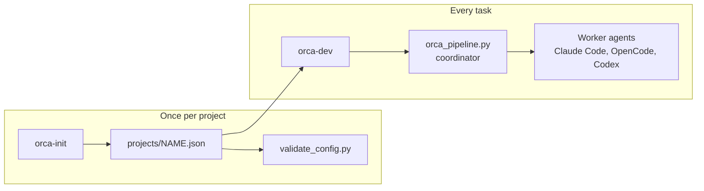
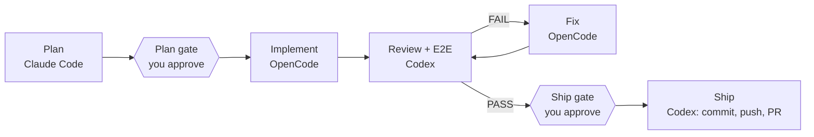

# orca-pipeline

Run a feature or bug fix through three coding agents in
[Orca](https://www.onorca.dev) ([source](https://github.com/stablyai/orca)),
with you in control of every decision that matters.

This is an independent community project built on Orca's public CLI. It isn't
affiliated with or endorsed by the Orca team. For Orca itself, see the
[official documentation](https://www.onorca.dev/docs).

- **Claude Code** plans and designs the change.
- **OpenCode** implements the plan.
- **Codex** reviews the change, runs the tests, and optionally runs end-to-end
  checks.
- When the review passes, Codex can commit, push, and open a pull request, but
  only after you approve it.

Each agent loads the skills that fit the task (for example a debugging skill for
a bug fix, or a security review skill for login code), and each project gets its
own configuration for test commands, rules, and URLs.

## Contents

- [How it works](#how-it-works)
- [Requirements](#requirements)
- [Installation](#installation)
- [Quick start](#quick-start)
- [Commands](#commands)
- [The pipeline in detail](#the-pipeline-in-detail)
- [Project configuration](#project-configuration)
- [Onboarding a project with orca-init](#onboarding-a-project-with-orca-init)
- [Why this works with Orca](#why-this-works-with-orca)
- [Safety and control](#safety-and-control)
- [Files](#files)
- [Troubleshooting](#troubleshooting)
- [Limitations](#limitations)
- [References](#references)
- [License](#license)

## How it works

There are two commands. You run `orca-init` once per project, and `orca-dev`
once per task.



1. `orca-init` inspects a project and writes its configuration file. It runs
   Claude Code without a chat (headless) to read the project and decide the test
   commands, rules, URLs, and skills.
2. `orca-dev` switches the project to a task branch and opens a coordinator tab
   in Orca.
3. The coordinator (`orca_pipeline.py`) starts one agent per stage, waits for
   each result, asks you at the approval points, and loops on review failures.

Inside the coordinator, one task moves through these stages:



## Requirements

- `zsh`, `git`, and Python 3 (tested with Python 3.12 on macOS). The scripts use
  the Python standard library only.
- [Orca](https://www.onorca.dev/docs/install) with its `orca` CLI, running.
  See the [CLI overview](https://www.onorca.dev/docs/cli/overview).
- The agent CLIs you configure, signed in: `claude` (Claude Code), `opencode`,
  and `codex`. Orca must be able to launch each one.
- For the ship stage: `gh` (GitHub CLI), signed in, a GitHub remote named
  `origin`, and a commit-and-pull-request skill for the ship agent (see
  [Limitations](#limitations)).
- Optional: Docker, when your project runs inside a container.
- Optional: the skills your modes name (for example `dev-workflow` or
  `systematic-debugging`). `validate_config.py` tells you which ones an agent
  can't see.

## Installation

1. Clone the repository. The default location is `~/orca-pipeline`:

   ```bash
   git clone https://github.com/<you>/orca-pipeline.git ~/orca-pipeline
   ```

2. Load the shell commands from `~/.zshrc`:

   ```bash
   echo '[[ -f ~/orca-pipeline/orca-dev.zsh ]] && source ~/orca-pipeline/orca-dev.zsh' >> ~/.zshrc
   ```

3. Open a new terminal and check that the commands exist:

   ```bash
   orca-dev --help
   ```

If you clone somewhere else, set `ORCA_PIPELINE_DIR` to that folder before the
`source` line.

Your project configurations live in `projects/`. They contain local paths, so
keep that folder out of Git (see [Files](#files)).

## Quick start

1. Onboard a project. Look at what `orca-init` finds first, then let it write
   the configuration:

   ```bash
   orca-init ~/code/my-app --dry-run
   orca-init ~/code/my-app
   ```

2. Read `projects/my-app.init-report.md`, mainly the **Open questions** section,
   and adjust `projects/my-app.json` where needed.

3. See which modes and skills the project has:

   ```bash
   orca-dev my-app --help
   ```

4. Try a dry run. It prints every instruction the agents would receive and
   starts nothing:

   ```bash
   orca-dev my-app fix invoice-rounding "Invoice totals round the wrong way" --dry-run
   ```

5. Run it for real, and stay near the coordinator tab that opens in Orca:

   ```bash
   orca-dev my-app fix invoice-rounding "Invoice totals round the wrong way"
   ```

## Commands

### `orca-dev`

Creates the task branch, then runs the pipeline in a new Orca tab named
`coord-<slug>`.

```text
orca-dev <project> <type> <slug> "<task>" [--mode <mode>] [--no-branch] [pipeline flags]
orca-dev <project> --help      modes and skills of that project
orca-dev --help                full help
orca-dev --list                projects that have a configuration
```

| Argument | Meaning |
| --- | --- |
| `<project>` | The name of a configuration in `projects/<project>.json`. |
| `<type>` | Branch prefix: `feature`, `fix`, `improve`, or `hotfix`. The branch is `<type>/<slug>`. |
| `<slug>` | A short kebab-case name. It also names the plan file, the review file, and the tab. |
| `"<task>"` | What to build or fix, in plain words. |

The **mode** decides which skills each agent loads. Without `--mode`, `fix` and
`hotfix` use `bugfix`, and `feature` and `improve` use `small`. Pass `--mode`
for other kinds of work:

| Mode | Use it for |
| --- | --- |
| `small` | A small or medium change: a field, a filter, a report column. |
| `bugfix` | Something broken: an error, a wrong number, a crash. |
| `ui` | Screens, layout, forms, and styling. |
| `secure` | Login, permissions, user input, money, and file uploads. |
| `large` | A large feature across several modules. |
| `scratch` | A new module or project from zero. |

Options:

| Option | What it does |
| --- | --- |
| `--mode <mode>` | Uses that mode's skills for this run. |
| `--no-branch` | Stays on the current branch. |
| `--dry-run` | Prints every worker instruction. Starts no agent and switches no branch. |
| `--e2e` | Also runs the end-to-end worker, in parallel with the review. |
| `--module a,b` | Limits end-to-end checks to these modules from the configuration. |
| `--start-at <stage>` | Starts at `plan`, `implement`, `review`, or `ship`, to skip finished stages. |
| `--known-failures "..."` | Names tests that already fail before your change. |
| `--resume-run <runId>` | Continues an existing run from the same coordinator tab. |

How the branch step works:

- A new branch starts from a freshly fetched base branch on `origin`.
- An existing local or remote branch with that name is reused.
- Uncommitted files come along to the new branch. If they conflict with the
  switch, Git refuses, nothing is discarded, and `orca-dev` stops.

The **base branch** is the first of these that exists on `origin`:
`ship.base_branch` from the configuration, then `staging` for projects under
`~/Sites/`, then the remote's default branch, then `main`, then `master`. If
`orca-dev` falls back to another branch, it tells you which one and why.

### `orca-init`

Writes the configuration for a project. See
[Onboarding a project with orca-init](#onboarding-a-project-with-orca-init).

```text
orca-init <path> [<path> ...]
orca-init <path> --name <name>
orca-init --all [--root <folder>] [--root <folder>]
orca-init --help
```

### `validate_config.py`

Checks a configuration without starting any agent:

```bash
python3 ~/orca-pipeline/validate_config.py ~/orca-pipeline/projects/my-app.json
```

It reports **errors** and **warnings**:

- **Errors:** a missing key, a `path` that isn't a Git checkout, a mode stage
  without skills, or a skill that the agent of that stage can't see.
- **Warnings:** a test command that can't start here (a stopped container, a
  missing binary), an end-to-end URL that doesn't answer, or a base branch that
  falls back.

## The pipeline in detail

The coordinator runs in an Orca terminal tab and works through four stages.

1. **Plan (Claude Code).** Claude writes `docs/plans/<slug>.md` with the goal,
   the files to change, the steps, a test plan, and acceptance criteria. It
   doesn't write application code.

   At the **plan gate** you answer:
   - `y` to continue.
   - `r <notes>` to have Claude revise the plan.
   - `q` to stop.

2. **Implement (OpenCode).** OpenCode implements the plan, runs the tests the
   plan names, and reports the test runner's summary lines. For a bug fix, it
   also reports the failing run from before the fix.

   If it reports a failure, the **failure gate** asks whether to review anyway.

3. **Review (Codex).** Codex reviews only the lines that changed, runs the
   full test suite once, and writes `docs/reviews/<slug>.md` with a PASS or
   FAIL verdict. It receives OpenCode's report as evidence.

   With `--e2e`, a second Codex worker runs end-to-end checks against the
   running app at the same time.

   On FAIL, OpenCode gets a **fix round** with the blocking issues, and Codex
   reviews again. This repeats up to `max_fix_rounds` times.

4. **Ship (Codex, optional).** After a PASS, the coordinator lists the files
   this run changed and asks at the **ship gate**:
   - `y` to commit, push, and open a pull request.
   - `w` to do the same and also follow the pull request's review.
   - `n` to stop and commit by hand.

   After `y` or `w`, you also type `push`. Anything else cancels.

While a worker runs, it may ask the coordinator a question. The coordinator
shows it in the tab and waits for your answer. You can answer in three ways:

- Type the answer on one line.
- Type `@<path>` to send the contents of a file.
- Write the answer to `.orca-pipeline/<slug>.answer` in the project folder.

If nobody answers within `question_timeout_min` minutes, the worker is told to
use its best judgment and to note the assumption.

### What you see in Orca

- **Tabs:** one coordinator tab, plus one tab per worker. Don't close a worker
  tab while it works, because that stops the worker.
- **Board:** the project's card moves to **In progress**, then **In review**,
  then **Completed**. When the pipeline waits for you or stops, the card gets a
  comment and an unread dot.
- **Log:** `.orca-pipeline/<slug>.log` in the project folder. Git ignores it
  through `.git/info/exclude`.

## Project configuration

Each project has one JSON file in `projects/`. The scripts are generic. Every
project-specific choice lives in this file.
[`examples/laravel-docker.example.json`](examples/laravel-docker.example.json)
is a full example for a Laravel application that runs in Docker.

| Key | Purpose |
| --- | --- |
| `project`, `path` | The project name and its checkout folder (`~` is allowed). |
| `test_command` | The fallback test command. |
| `test_commands.implement`, `test_commands.review` | Test commands per stage. Typically only the named tests while implementing, and the full suite once in review. |
| `known_failures` | Tests that already fail on the base branch, or `"none"`. |
| `plan_dir`, `review_dir` | Where plans and review reports go. Defaults: `docs/plans`, `docs/reviews`. |
| `agents` | The agent for each stage: `plan`, `implement`, `review`, `e2e`, `ship`. |
| `modes` | Named skill sets, each with a `plan`, `implement`, and `review` list. |
| `gates.after_plan`, `gates.after_failure`, `gates.before_fix` | Which approval points are on. |
| `answer_questions` | `"ask_me"` to answer worker questions yourself, or `"auto"`. |
| `question_timeout_min` | Minutes a worker question waits for you. Default 15. |
| `stage_timeout_min`, `max_fix_rounds` | How long a stage may take, and how many fix rounds run. Defaults: 45 and 2. |
| `board` | Whether to move the Orca board card, and the status names to use. |
| `e2e` | `enabled`, `base_url`, `modules` (name to path), `login_note`, `skills`, and `files_dir`. |
| `ship` | `enabled`, `skills`, `base_branch`, `follow_review`, and `timeout_min`. |
| `extra_rules` | Extra sentences added to each stage's instructions, keyed by stage. |
| `skill_phrases` | Optional. Overrides how a skill list is phrased for an agent. |

### How agents are told to use skills

The coordinator adds one sentence per stage, phrased the way each agent expects:

| Agent | Sentence |
| --- | --- |
| Claude Code | "Invoke the Skill tool for each of these skills, in order, before you start: ..." |
| OpenCode | "Load each of these skills with your skill tool before you start: ..." |
| Codex | "Use these skills: $skill-a, $skill-b." |

A skill only works if that agent can find it. `validate_config.py` checks these
folders:

| Agent | Skill folders |
| --- | --- |
| Claude Code | `~/.claude/skills`, the project's `.claude/skills`, and installed plugins (`<plugin>:<skill>`) |
| OpenCode | `~/.config/opencode/skills`, `~/.claude/skills`, `~/.agents/skills`, and the project's `.opencode/skills`, `.claude/skills`, and `.agents/skills` |
| Codex | `~/.agents/skills`, `~/.codex/skills`, and the project's `.agents/skills` |

## Onboarding a project with orca-init

`orca-init` writes `projects/<name>.json` for you. It works for any Git
checkout, inside or outside `~/Sites`, with or without Docker.

For each project, it does four things:

1. Adds the folder to Orca (`orca repo add`), and adds `.orca-pipeline/` to the
   project's `.git/info/exclude`.
2. Collects facts it can check itself:
   - Branches on `origin`, and the remote host.
   - Stack versions from `composer.json` and `package.json`.
   - The runtime. If a running Docker container mounts the folder, it records
     the container and the PHP and PHPUnit versions inside it. Otherwise it
     records this machine's PHP, Node, or Python version, version pin files,
     and whether dependencies are installed.
   - A `<name>.local` host, or the dev-server scripts.
   - The skills each agent can see from that folder.
3. Runs `claude -p` in the project folder with `init-prompt.md` and those facts.
   Claude reads the project's rules files, routes, and test setup, then writes
   two files. The permissions are narrow:
   - It may read the project and write only `projects/<name>.json` and
     `projects/<name>.init-report.md`.
   - It may not edit the project, read `.env` files or keys, run Docker, or
     browse the web.
   - A cost cap applies (`--budget-usd`, default 5).
4. Checks the result with `validate_config.py` and a pipeline dry run, then
   prints PASS or FAIL.

Claude shapes each new configuration after a reference. By default that's
`examples/laravel-docker.example.json`. If `local-reference.json` exists in
the repository folder, `orca-init` uses it instead. Copy your best project
configuration there to give new projects your own skills and rules. It stays
out of Git.

Options:

| Option | Use it when |
| --- | --- |
| `--dry-run` | You want to see the facts and the Claude command first. Nothing changes. |
| `--force` | The project's setup changed. The old configuration is kept as `<name>.json.bak` and restored if the run fails. |
| `--name <name>` | Two folders share a name, for example `~/Sites/app/api` and `~/code/api`. |
| `--all [--root <folder>]` | You want every Git repository directly under a folder. The default root is `~/Sites/app`. |
| `--no-register` | You don't want the folder added to Orca. |
| `--model <id>` | You want a specific Claude model for onboarding. |

After a run:

1. Read `projects/<name>.init-report.md`. It lists each decision with evidence
   (`file:line`) and the open questions, such as a test user, a base branch, or
   tests that can't run on this machine.
2. Edit `projects/<name>.json` where needed, then run `validate_config.py`
   again.
3. Run `orca-dev <name> --help`, then try a task with `--dry-run`.

## Why this works with Orca

Orca provides the building blocks. The coordinator combines them into a fixed
order, with gates in between. The official
[orchestration guide](https://www.onorca.dev/docs/cli/orchestration) and
[CLI reference](https://www.onorca.dev/docs/cli/reference) describe each
command in full.

| Need | Orca command | Used by |
| --- | --- | --- |
| Add a project | `orca repo add --path` | `orca_init.py` |
| Open the coordinator tab from any terminal | `orca terminal create --worktree ... --command ...` | `orca-dev` |
| Group the workers under one run | `orca orchestration run-create`, bound to the coordinator tab | `Pipeline.run()` |
| Start an agent as a worker | `orca orchestration worker-start --agent <id> --spec ... --worktree current` | `Pipeline.start()` |
| Wait for results | `orca orchestration check --wait --ack` | `Pipeline.wait_all()` |
| Answer a worker's question | `orca orchestration reply` | `Pipeline.answer_question()` |
| Clean up a worker | `orca orchestration worker-release` | `Pipeline.wait_all()` |
| Move the board card | `orca worktree set --workspace-status/--comment/--unread` | `Pipeline.board()` |

`worker-start` is the key piece:

- Orca opens the agent's CLI in a new tab, in the same folder as the
  coordinator.
- Orca adds a preamble to the agent's instructions. The preamble tells the agent
  how to report back (`worker_done` with an outcome) and how to ask a question.
- That's why three different agents can be coordinated the same way.

An Orca run doesn't schedule workers by itself. The coordinator decides the
order, waits, applies the gates, and runs the fix loop.

All workers share one folder. This matters when a project runs in Docker: the
container usually mounts only the main checkout, so tests can't run in a
separate Git worktree.

## Safety and control

- **One writer at a time.** Implement and fix workers never run together.
  Review and end-to-end workers can run together, because each writes only its
  own report.
- **Workers report, you verify.** A `worker_done` message is a claim. Check
  `git diff` and run the tests yourself before you approve the ship gate.
- **Nothing ships without you.** Before the ship stage, workers are told not to
  commit, push, or switch branches. The ship gate needs your answer and the
  typed word `push`, and an answer file can't approve a push.
- **Only this run's files are committed.** When a run starts, the coordinator
  records files that were already changed or untracked. The ship worker may
  stage only files that changed after that. It may never stage plan and review
  reports, `.orca-pipeline/`, or database dumps (`.sql`, `.dump`, `.sqlite`,
  `.db`), and it scans the staged diff for credentials before committing.
- **Stale input is dropped.** Anything typed while no question is open is
  discarded before the next prompt, so a stray line can't answer a gate.
- **No input length limit.** The coordinator reads the terminal itself, so long
  answers aren't cut off by the terminal's line limit.
- **No endless waiting.** Worker questions time out after
  `question_timeout_min`. Gates never time out.
- **Evidence travels in reports.** Implementers quote test runner output in
  their report, the coordinator passes it to the next review, and fix workers
  may not edit review reports.

## Files

| File | Role |
| --- | --- |
| `orca-dev.zsh` | Shell commands `orca-dev` and `orca-init`, the branch step, and help. |
| `orca_pipeline.py` | The coordinator: stages, gates, worker instructions, input handling, and board updates. |
| `orca_init.py` | Onboarding: fact collection, the headless Claude run, and validation. |
| `init-prompt.md` | Instructions Claude follows when it writes a configuration. |
| `validate_config.py` | Configuration checks, also used by `orca_init.py`. |
| `examples/laravel-docker.example.json` | A full example configuration (Laravel in Docker). |
| `local-reference.json` | Optional and local. Your own reference configuration for `orca-init`. Keep it out of Git. |
| `projects/` | Your project configurations and onboarding reports. Keep it out of Git. |

A suggested `.gitignore`:

```gitignore
projects/
local-reference.json
__pycache__/
*.log
```

The pipeline writes these files inside each project:

| File | Commit it? |
| --- | --- |
| `docs/plans/<slug>.md` | No. It's a working document for this run. |
| `docs/reviews/<slug>.md` | No. It's a working document for this run. |
| `.orca-pipeline/<slug>.log`, `.baseline.json`, `.answer` | No. Git ignores them through `.git/info/exclude`. |

## Troubleshooting

| Symptom | What to do |
| --- | --- |
| `Run this inside an Orca terminal` | Start the pipeline with `orca-dev`, or from a terminal tab inside Orca. |
| `orca-dev: command not found` | Add the `source` line to `~/.zshrc`, then open a new terminal or run `source ~/.zshrc`. |
| `Could not switch to <branch>` | Your local changes conflict with the new branch. Commit, stash, or move them, or use `--no-branch`. |
| A worker waits for approval in its tab | Some agents ask before they run certain commands, such as Docker. Answer in that worker's tab. |
| The review fails only because evidence is missing | Check the implementer's report in the log. Answer the reviewer's question, or rerun with `--start-at review`. |
| `validate_config.py` says a skill isn't visible | Install the skill where that agent looks (see the skill folders table), or remove it from the mode. |
| A stage times out | Raise `stage_timeout_min`, or rerun from that stage with `--start-at`. |

## Limitations

- The coordinator trusts each worker's reported outcome. A PASS means the
  reviewer reported PASS, not that you have verified it.
- Running the review and end-to-end workers in parallel has only been tested
  with stubbed workers. Real runs so far used one worker at a time.
- `orca-init` can't confirm things it isn't allowed to read, such as values in
  `.env`. These appear as open questions in the report.
- The ship stage relies on a commit-and-pull-request skill named in
  `ship.skills`. No such skill is part of this repository (the example names a
  placeholder, `your-pr-skill`), so bring your own or turn the stage off. It also needs the GitHub
  CLI. For other hosting, set `"ship": {"enabled": false}` and commit by hand.

## References

Orca, the official sources:

- [Orca website](https://www.onorca.dev) and
  [documentation](https://www.onorca.dev/docs)
- [Source code on GitHub](https://github.com/stablyai/orca),
  [releases](https://github.com/stablyai/orca/releases), and
  [changelog](https://www.onorca.dev/changelog)
- [Install Orca](https://www.onorca.dev/docs/install)
- [CLI overview](https://www.onorca.dev/docs/cli/overview) and
  [CLI reference](https://www.onorca.dev/docs/cli/reference)
- [Orchestration](https://www.onorca.dev/docs/cli/orchestration): runs,
  workers, messages, and the coordinator loop this project builds on
- [Skills](https://www.onorca.dev/docs/cli/skills)
- [Worktrees](https://www.onorca.dev/docs/model/worktrees)
- [Supported agents](https://www.onorca.dev/docs/agents/supported)
- [Running agents in parallel](https://www.onorca.dev/docs/recipes/parallel-agents)
- [Community plugins](https://github.com/stablyai/orca-community-plugins)

The installed `orca` CLI also carries a guide that matches its version. Print it
with:

```bash
orca skills get orca-cli
```

Agent and tool documentation:

- [Claude Code](https://code.claude.com/docs/en/overview)
- [OpenCode](https://opencode.ai/docs)
- [Codex CLI](https://github.com/openai/codex)
- [GitHub CLI](https://cli.github.com)
- [Mermaid](https://mermaid.js.org), for the diagrams in this README

## License

[MIT](LICENSE)
